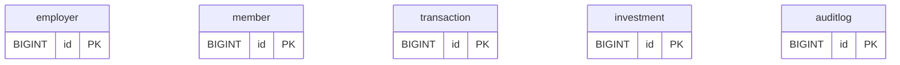

# Database ERD

## Database Architecture Summary & Scope
The database design is grounded in architecture component managed data entities. Target engine and unconfirmed technology choices are TBD unless the architecture specifies them.

## Mermaid.js Entity Relationship Diagram

## Data Dictionary / Table Definitions
| Table | Column | Data Type | Constraints | Description |
|---|---|---|---|---|
| employer | id | BIGINT | PK | Source-backed or proposed schema attribute. |
| member | id | BIGINT | PK | Source-backed or proposed schema attribute. |
| transaction | id | BIGINT | PK | Source-backed or proposed schema attribute. |
| investment | id | BIGINT | PK | Source-backed or proposed schema attribute. |
| auditlog | id | BIGINT | PK | Source-backed or proposed schema attribute. |

## Relationship & Cardinality Mapping
No foreign-key relationships are asserted by the available source data. Confirm parent/child ownership and cardinality before implementation.

## Traceability Matrix
| Table Name | Source Component ID | Source Data Entity |
|---|---|---|
| employer | COMP-ONBOARDING-1 | Employer |
| member | COMP-ONBOARDING-1 | Member |
| transaction | COMP-CONTRIBUTIONS-2 | Transaction |
| investment | COMP-INVESTMENTS-3 | Investment |
| auditlog | COMP-COMPLIANCE-5 | AuditLog |
